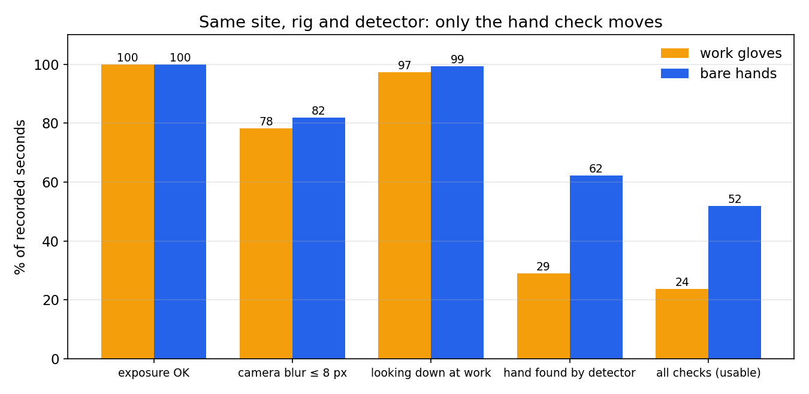
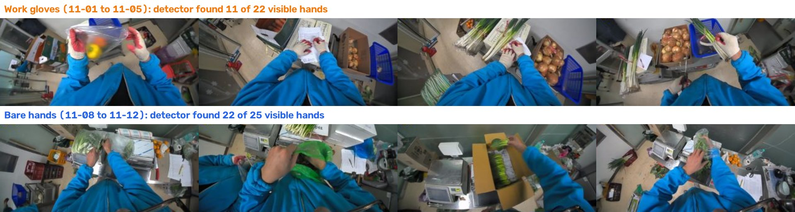
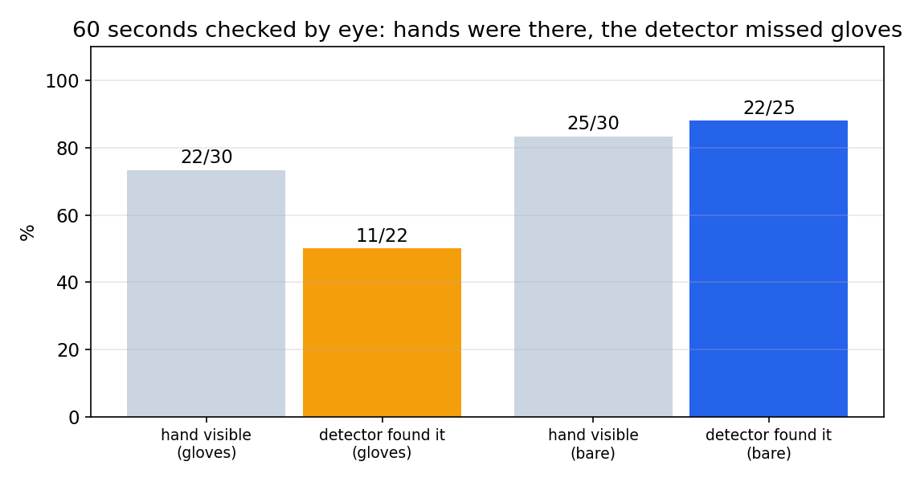
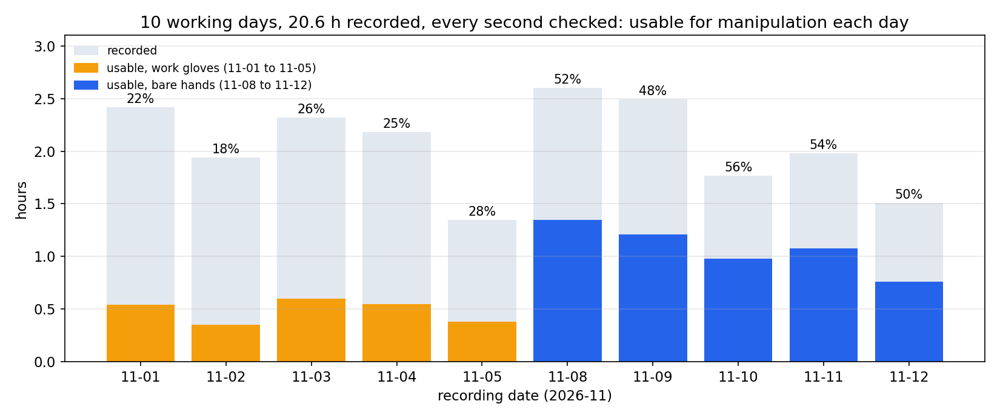

<!-- ODL_QUALITY_V2 -->

# Origin Data Lab · Technical Field Note #27

**ODL Usable Time QC 10 Days Gloves vs Bare**

[](https://github.com/origin-data-lab/ten-day-usable-time-qc-work-gloves-vs-bare-hands) [](https://huggingface.co/datasets/origin-data-lab/ten-day-usable-time-qc-work-gloves-vs-bare-hands) [](https://www.kaggle.com/datasets/origindatalab/odl-usable-time-qc-gloves-vs-bare) [](https://origindatalab.io/technical-field-notes/ten-day-usable-time-qc-work-gloves-vs-bare-hands.html)

[English technical note](https://origindatalab.io/technical-field-notes/ten-day-usable-time-qc-work-gloves-vs-bare-hands.html) | [Korean technical note](https://origindatalab.io/ko/technical-field-notes/ten-day-usable-time-qc-work-gloves-vs-bare-hands.html)

---

# ODL Field Note #27 — Per-second usable-time QC over ten working days, work gloves vs bare hands
```bash
pip install opencv-python-headless mediapipe==0.10.14 numpy pandas matplotlib   # ffmpeg on PATH
python3 analysis/fn27_pass2.py <budget_s> 0 1   # keyframes, SEI timing (device reader withheld), hands
python3 analysis/fn27_imu.py 600                # IMU cache (device reader withheld)
python3 analysis/fn27_qc.py <out_dir>
python3 analysis/fn27_review.py glove; python3 analysis/fn27_review.py bare
python3 analysis/fn27_figs.py <out_dir>
```
Included: the full per-second QC index (74,044 rows), per-day and per-group summaries, and the 60-second manual review. Images and raw recordings are not distributed.
Licence: Creative Commons Attribution 4.0 International (CC BY 4.0) for derived data and figures; MIT for code.

<!-- ODL_ENTITY_V1 -->
## About Origin Data Lab

**Origin Data Lab** (origindatalab.io, OriginDataLab Co., Ltd.) is a real-world data collection company based in **Yangyang, Gangwon State, South Korea**. We plan and run egocentric, stereo+IMU and field video capture for physical AI and robotics teams, with documented QA such as the measurements in this dataset. Not affiliated with "Origin Lab" (game data) or "OriginLab" (Origin/OriginPro software).

- **[Request sample data](https://origindatalab.io/contact.html?topic=sample&note=fn27&utm_source=github&utm_medium=referral&utm_campaign=field-notes)**: stereo+IMU or phone+IMU egocentric capture
- **[Custom data collection](https://origindatalab.io/data-services.html?utm_source=github&utm_medium=referral)**: field capture in South Korea and Bangladesh
- **[All technical field notes](https://origindatalab.io/technical-field-notes/?utm_source=github&utm_medium=referral)**

## Visual evidence

Figures are taken from the released technical-note package. Interpret with the original methods and limitations.

### Figure 1



*Pass rate of each check, glove days vs bare-hand days.*

### Figure 2



*Examples from the 60 seconds checked by eye. Top: work gloves. Bottom: bare hands.*

### Figure 3



*60 seconds checked by eye.*

### Figure 4



*Recorded (grey) and usable (colour) hours per day.*


---

## Explore Origin Data Lab

[](https://github.com/origin-data-lab/ten-day-usable-time-qc-work-gloves-vs-bare-hands) [](https://huggingface.co/datasets/origin-data-lab/ten-day-usable-time-qc-work-gloves-vs-bare-hands) [](https://www.kaggle.com/datasets/origindatalab/odl-usable-time-qc-gloves-vs-bare) [](https://origindatalab.io/technical-field-notes/ten-day-usable-time-qc-work-gloves-vs-bare-hands.html)

[Official Website](https://origindatalab.io/) | [Technical Field Notes](https://origindatalab.io/technical-field-notes/) | [English Note](https://origindatalab.io/technical-field-notes/ten-day-usable-time-qc-work-gloves-vs-bare-hands.html) | [Korean Note](https://origindatalab.io/ko/technical-field-notes/ten-day-usable-time-qc-work-gloves-vs-bare-hands.html)

[GitHub](https://github.com/origin-data-lab/ten-day-usable-time-qc-work-gloves-vs-bare-hands) | [Hugging Face](https://huggingface.co/datasets/origin-data-lab/ten-day-usable-time-qc-work-gloves-vs-bare-hands) | [Kaggle Dataset](https://www.kaggle.com/datasets/origindatalab/odl-usable-time-qc-gloves-vs-bare) | [Kaggle Notebook](https://www.kaggle.com/code/origindatalab/odl-usable-time-qc-gloves-vs-bare-notebook)
